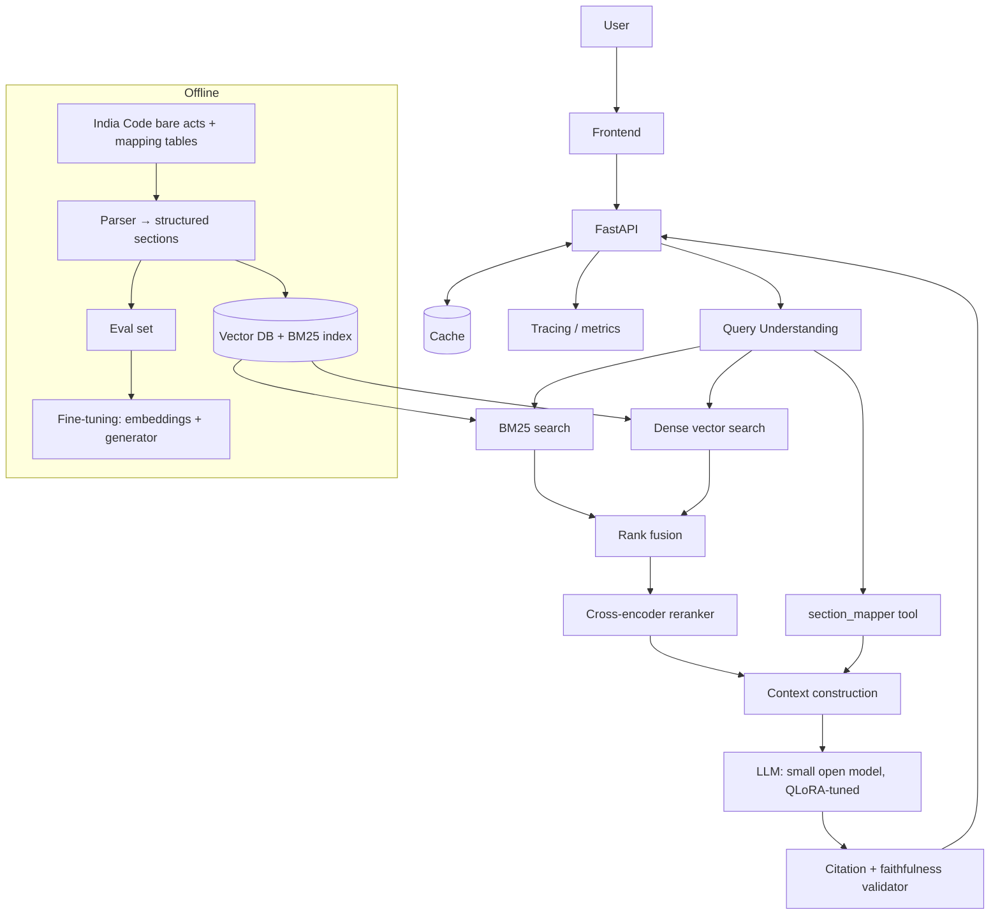

# NyayaSetu — Grounded Indian Criminal-Law Assistant

> **This file is the project's source of truth.** Read it before every major step. Update it whenever architecture, status, decisions, experiments, or learning progress change.

_Last updated: 2026-10-24 · Phase 1 (Data pipeline) complete · Phase 2 next_

---

## Project Vision

A legal research assistant for India's new criminal laws: Bharatiya Nyaya Sanhita (BNS), Bharatiya Nagarik Suraksha Sanhita (BNSS) and Bharatiya Sakshya Adhiniyam (BSA). They replaced the IPC, CrPC and Indian Evidence Act on 1 July 2024.

Every answer must be **grounded in the actual statute text, cite exact sections, map old ↔ new section numbers, and refuse when the law doesn't cover the question.**

The engineering thesis we want to prove with measurements:

> *A small, fine-tuned, open-source model with a well-engineered retrieval pipeline can match or beat a large general-purpose model on citation faithfulness, at a fraction of the serving cost.*

## Problem

- The 2024 law change means millions of people (students, lawyers, police, citizens) must relearn section numbers and wording.
- Statutes are written in formal legal language; people ask in everyday English or Hinglish. Keyword search misses the connection.
- General chatbots **hallucinate** section numbers and punishments confidently. In law, a wrong citation is worse than no answer.

## Goals

1. Answer natural-language questions about BNS/BNSS/BSA with **section-level citations**.
2. Map IPC/CrPC/IEA sections ↔ BNS/BNSS/BSA sections reliably, using a lookup tool rather than model memory.
3. **Abstain** ("not covered / I'm not sure") when the retrieved law doesn't support an answer.
4. Measure everything: retrieval quality, citation accuracy, faithfulness, abstention, latency, cost.
5. Run real experiments: no-RAG vs RAG, chunking strategies, dense vs hybrid retrieval, with/without reranking, base vs fine-tuned embeddings, base vs QLoRA-tuned generator, quantization trade-offs.
6. Serve it as a deployed web app with an API, caching, and monitoring.

## Non-goals

- **Not legal advice.** The product shows a clear disclaimer and is positioned as a study/research aid.
- Not covering all Indian law: scope is the three new criminal codes plus their old counterparts. Case law is a stretch goal only.
- Not training an LLM from scratch, which is neither necessary nor feasible.
- Not a polished consumer product: the focus is engineering depth and measured results.

---

## Complete End-to-End Architecture

```text
User (browser)
 ↓
Frontend (chat UI: answer + clickable citations + old↔new mapping panel)
 ↓
API (FastAPI) ── response cache (exact + semantic)
 ↓
Application Layer (request validation, session, logging/tracing)
 ↓
GenAI Pipeline
 ├── 1. Query Understanding
 │     ├── detect explicit section refs ("IPC 420", "Section 302")
 │     ├── query rewriting (casual → legal phrasing)
 │     └── scope check (is this a criminal-law question at all?)
 ├── 2. Tools
 │     └── section_mapper(old_code, section) → new section(s)
 ├── 3. Retrieval
 │     ├── Sparse/keyword search (BM25)
 │     ├── Dense search (embeddings + vector DB)
 │     ├── Fusion (Reciprocal Rank Fusion)
 │     └── Reranking (cross-encoder)
 ├── 4. Context Construction (dedupe, order, token budget, section metadata)
 ├── 5. Generation (LLM → structured JSON: answer, citations[], confidence, abstain flag)
 └── 6. Response Validation
       ├── citation exists? (section IDs checked against the database)
       ├── citation supports claim? (faithfulness check)
       └── fallback to abstention if validation fails
 ↓
Evaluation / Observability (traces, latency, token cost, offline eval suite)
 ↓
Response
```

## Architecture Diagram



## Complete User-to-Response Workflow

1. User asks: *"Someone took money from me promising a job and vanished — what's the punishment, and what was the old IPC section?"*
2. API checks the cache. On a miss, it continues.
3. Query understanding: no explicit section number found; rewrites to legal phrasing ("cheating, dishonest inducement to deliver property"); scope check passes.
4. Retrieval: BM25 and dense search each return top-k sections; fusion merges them; the reranker keeps the best ~5.
5. Tool call: the cheating section found in BNS is mapped back to its IPC equivalent via `section_mapper`.
6. Context construction: the selected sections' text, IDs and titles are packed within the token budget.
7. The LLM produces structured JSON: answer text, the citation for each claim, the mapping, and an abstain flag.
8. The validator confirms every cited section exists and supports its claim. If not, it rejects the claim or abstains.
9. The response is returned with clickable citations; the trace (latency, tokens, retrieved IDs) is logged.

---

## Technology Stack

_Tentative. Final choices are recorded in **Architecture Decisions** as we make them._

| Layer | Choice | Why |
|---|---|---|
| Language | Python 3.11+ | Standard for AI work |
| Data parsing | `pypdf` / `pdfplumber`, regex, Pydantic | Turn bare-act PDFs into structured sections |
| Keyword search | BM25 (`rank_bm25` or `bm25s`) | Exact legal terms and section numbers |
| Embeddings | Open model, BGE/E5 family (`sentence-transformers`) | Free, strong, fine-tunable |
| Vector database | Qdrant (local via Docker) | Supports metadata filters and hybrid search; production-grade |
| Reranker | Open cross-encoder (BGE-reranker family) | Big precision gain for a small latency cost |
| Generator LLM | Small open instruct model (Qwen/Llama family, ~3–8B); exact model chosen in Phase 5 | Fine-tunable on free GPUs; cheap to serve |
| Teacher / baseline | One hosted API LLM | Synthetic data generation and comparison baseline |
| Fine-tuning | Hugging Face `transformers` + `peft` (LoRA/QLoRA), `bitsandbytes`; possibly Unsloth | Standard, fits on a free T4 GPU |
| Serving | vLLM (GPU) or llama.cpp / Ollama (CPU, quantized) | Fast, cheap inference |
| API | FastAPI | Async, typed, auto-docs |
| Frontend | Streamlit/Gradio first; maybe React later | Spend effort on AI, not CSS |
| Caching | Redis or in-process (exact + semantic cache) | Latency and cost |
| Observability | Structured logs + Langfuse or OpenTelemetry | Traces per request |
| Experiment tracking | CSV/JSON results + MLflow or Weights & Biases | Reproducible experiments |
| Packaging | Docker + docker-compose | One-command run |
| Compute | Laptop (dev), Google Colab / Kaggle free GPUs (training) | Zero-budget friendly |

## Models

| Role | Model (planned) | What it does |
|---|---|---|
| Embedding | BGE/E5-family, then our fine-tuned version | Turns text into vectors so similar meanings sit close together |
| Reranker | Cross-encoder | Reads query + candidate together and scores relevance precisely |
| Generator | Small open decoder-only transformer, then our QLoRA-tuned version | Writes the cited answer |
| Teacher | Hosted large LLM | Generates synthetic training questions; serves as baseline |
| Judge (eval only) | Hosted LLM + rule checks | Grades faithfulness; calibrated against our own human labels |

**Core architecture to learn deeply:** the decoder-only Transformer, covering tokenization → embeddings → attention → next-token prediction → sampling.

## Data Pipeline

1. **Sources:** BNS, BNSS and BSA (Gazette text via PRS India, with India Code as the preferred source when reachable; see ADR-7, ADR-9). Old↔new correspondence tables come in Phase 5.
2. **Parse:** PDF → positioned words → body lines + margin notes (layout.py) → sections via a sequence-checked state machine (sections.py). Paragraph breaks are kept at (1)/(a)/Explanation/Illustration/Exception/Provided.
3. **Structure:** each section becomes a `SectionRecord` `{id, act, number, title, chapter, chapter_title, heading, text, page_start, page_end, act_refs, source}`, validated with Pydantic (`schema.py`).
4. **Quality checks:** section counts match the official acts; no empty or duplicate sections; spot-check by hand.
5. **Store:** JSONL (source of truth) → BM25 index + Qdrant collection.
6. **Eval data:** a hand-written gold set of 150–300 questions, each labelled with correct section(s) and including out-of-scope and trick questions.

## RAG Pipeline

Query → rewrite → [BM25 ∥ dense] → RRF fusion → cross-encoder rerank → top-k → context builder → LLM → validator.

Chunking strategies to compare: fixed-size tokens · whole section · section with sub-parts split out · parent-child (retrieve small part, send the full section).

## Training/Fine-tuning Pipeline

**A. Embedding fine-tuning**
- Use the teacher LLM to generate realistic user questions for each section, giving (question, section) pairs.
- Train with a contrastive loss (e.g. MultipleNegativesRankingLoss).
- Hold out sections to test generalization.

**B. Generator QLoRA fine-tuning**
- Build training examples: (question + retrieved context) → ideal structured, cited answer, plus abstention examples.
- Answers come from the teacher, then are filtered by the citation validator; keep a human-reviewed subset.
- Train with QLoRA (4-bit base model + LoRA adapters) on a free GPU.
- Compare against the same base model with prompting only.

## Inference Pipeline

- Quantized generator (4-bit/8-bit) served via vLLM or llama.cpp.
- Embedding + reranker models loaded once at startup.
- Exact-match cache plus a semantic cache for similar questions.
- Token-budgeted context; streaming responses.
- Measure p50/p95 latency, tokens/sec, memory, and cost per 1,000 queries.

## Evaluation Strategy

| What | Metric | How |
|---|---|---|
| Retrieval | Recall@k, MRR, nDCG | Against gold section labels |
| Citation accuracy | % cited sections that exist and are correct | Rule check vs database + gold |
| Faithfulness | % claims supported by cited text | LLM judge + human spot-check calibration |
| Answer correctness | Gold-answer agreement | Human + judge on a subset |
| Abstention | Precision/recall on out-of-scope questions | Labelled trick questions |
| Mapping accuracy | % correct old↔new | Against official tables |
| Performance | Latency p50/p95, memory, cost | Benchmark script |

**Rule:** every number in this file comes from an actual run, with the script and config recorded. No invented metrics.

## Deployment Architecture

`docker-compose`: API container + Qdrant + Redis + model server (vLLM on GPU host, or llama.cpp on CPU) + frontend. Target: a free/cheap host for the demo (e.g. Hugging Face Spaces or a small VM). The README documents both "run locally" and "run with a hosted model" modes.

---

## Project Phases

| # | Phase | Key concepts learned |
|---|---|---|
| 0 | Setup: environment, repo, `plan.md` | Project structure, git |
| 1 | Data: collect + parse acts and mapping tables into structured JSONL | Data pipelines, validation |
| 2 | Gold eval set + **no-RAG baseline** (watch LLMs hallucinate) | LLMs, tokens, prompting, hallucination |
| 3 | Dense retrieval: embeddings + Qdrant, RAG v1 | Embeddings, vector search, RAG |
| 4 | Retrieval upgrades: BM25, hybrid, reranking, chunking experiments | Hybrid retrieval, reranking, retrieval eval |
| 5 | Generation: structured cited output, `section_mapper` tool, validator, abstention | Transformers, structured output, tool calling |
| 6 | Evaluation harness: faithfulness, citations, abstention, LLM-as-judge | LLM evaluation |
| 7 | Fine-tune the embedding model | Training, loss, contrastive learning |
| 8 | QLoRA fine-tune the generator | Fine-tuning, LoRA, QLoRA, quantization |
| 9 | Inference optimization: quantization, serving, caching, latency | Inference, serving |
| 10 | API + frontend + observability | Production engineering |
| 11 | Deploy + README + evaluation report + resume material | Communication |

## Concepts I Need to Learn

Each concept is learned when its phase needs it. Status: ⬜ not yet · 🟨 in progress · ✅ understood + implemented

- ✅ Data pipelines: PDF text extraction, layout analysis by coordinates, regex, state-machine parsing, validation with schemas, automated tests, provenance (Phase 1)
- ⬜ What an LLM is / next-token prediction (Phase 2)
- ⬜ Tokens and tokenization (Phase 2)
- ⬜ Prompting and system prompts (Phase 2)
- ⬜ Hallucination (Phase 2)
- ⬜ Embeddings (Phase 3)
- ⬜ Vector similarity and vector databases (Phase 3)
- ⬜ RAG (Phase 3)
- ⬜ BM25 / keyword search (Phase 4)
- ⬜ Hybrid retrieval + rank fusion (Phase 4)
- ⬜ Reranking / cross-encoders (Phase 4)
- ⬜ Chunking (Phase 4)
- ⬜ Transformers + attention, conceptually (Phase 5)
- ⬜ Context windows and context construction (Phase 5)
- ⬜ Structured outputs (Phase 5)
- ⬜ Tool / function calling (Phase 5)
- ⬜ LLM evaluation, LLM-as-judge (Phase 6)
- ⬜ Training, loss and gradient descent, intuitively (Phase 7)
- ⬜ Fine-tuning (Phase 7)
- ⬜ LoRA (Phase 8)
- ⬜ Quantization + QLoRA (Phase 8)
- ⬜ Inference optimization + serving (Phase 9)
- ⬜ Caching (Phase 9)
- ⬜ APIs, monitoring, deployment (Phases 10–11)

---

## Completed Components

- ✅ Project selection (NyayaSetu chosen over 5 alternatives: best concept coverage with genuine need, public data, measurable hallucination story)
- ✅ `plan.md` created
- ✅ Phase 0: environment, repo skeleton, GitHub (2026-10-12)
- ✅ **Phase 1: data pipeline (2026-10-24).** Official PDFs → layout-aware extraction → section parser → Pydantic-validated dataset of **1,059 sections** (`data/processed/sections.jsonl`) with stable IDs (`BNS-103`), titles, chapters, sub-headings, page ranges, Act cross-references and provenance; **17/17 pytest checks pass**. Details below.

### Phase 1 — Data pipeline ✅ Complete (2026-10-24)

Code: `ingestion/download.py` → `ingestion/layout.py` → `ingestion/sections.py` → `ingestion/build.py` (+ `schema.py`, `tests/test_sections.py`, `scripts/probe_layout.py`, `scripts/check_sections.py`). Rebuild everything: `python -m nyayasetu.ingestion.download; python -m nyayasetu.ingestion.build; pytest -v`.

Data sources. The downloader tries them in order and records which one was used in `data/raw/sources.json`:
| Act | Local file | Primary: India Code (consolidated, updated) | Fallback: PRS India (Gazette text as enacted, Dec 2023) |
|---|---|---|---|
| BNS 2023 (Act 45) | `data/raw/bns.pdf` | https://www.indiacode.nic.in/bitstream/123456789/20062/1/a202345.pdf | https://prsindia.org/files/bills_acts/bills_parliament/2023/The%20Bharatiya%20Nyaya%20Sanhita,%202023.pdf |
| BNSS 2023 (Act 46) | `data/raw/bnss.pdf` | https://indiacode.nic.in/bitstream/123456789/20099/3/A2023-46.pdf | https://prsindia.org/files/bills_acts/bills_parliament/2023/The%20Bharatiya%20Nagarik%20Suraksha%20Sanhita,%202023.pdf |
| BSA 2023 (Act 47) | `data/raw/bsa.pdf` | https://www.indiacode.nic.in/bitstream/123456789/20063/1/aa202347.pdf | https://prsindia.org/files/bills_acts/acts_parliament/2023/The%20Bharatiya%20Sakshya%20Bill,%202023.pdf |

- ✅ 2026-10-24: all three acts downloaded via fallback from `prs_gazette` (BNS 1.4 MB, BNSS 2.0 MB, BSA 1.2 MB); India Code failed with RetryError for all three. **Corpus version = Gazette text as enacted, 25 Dec 2023.** Re-check India Code later for the consolidated version.
- ✅ Inspected raw text + measured layout with `scripts/probe_layout.py` (BNS pp. 3–4, A4 595×842 pt):
  - Running header at y≈64–68 → drop everything above y=75.
  - Body column x≈142–478. Indentation encodes structure: x≈166 = new paragraph/clause start, x≈142 = continuation line, x≈190 = nested item.
  - Margin notes outside the body column, on either side: x<135 (left) or x>485 (right). Two kinds: **section titles** ("Definitions.") and **cross-references to other Acts** ("40 of 2019.").
- ✅ Phase 1.2a: `layout.py` splits pages into body lines + margin notes → `data/interim/<act>_layout.txt` for inspection
  - v1 (fixed-x crop) chopped words in half ("Se|arate") → v2 classifies whole gap-separated segments.
  - v2 review (pp. 2, 10, 50): titles mostly perfect, header removed. Found: (a) **odd/even pages are offset by 24pt** (body starts x≈142 on odd pages, x≈118 on even), and on even pages the margin sits so close to the body that margin words merged into body lines (s.162); (b) two adjacent titles glued into one note (ss.165+166).
  - v3: classify each **word** by x0 (left margin if x0 < 114, right if x0 > 485); end a margin note at a line ending in "."; titles may sit above, beside or below their section's first line, so attach by vertical proximity in 1.2b.
  - ✅ v3 verified 2026-10-24: page 50 clean (ss.162–170 each with own title; "45 of 1950." etc. split); no body line starts in the margin zone anywhere in BNS.
- ✅ Phase 1.2b: `sections.py`, a line-by-line state machine: start at "CHAPTER I"; track chapter, chapter title, centred sub-headings; start a new section only when the number is exactly the next expected one; attach titles by nearest vertical distance (≤60pt, same page); act references ("45 of 1950") stored separately; stop at the signature block or Schedules.
  - Acceptance test: section counts must equal the known totals: **BNS 358, BNSS 531, BSA 170**.
  - Schedules (e.g. BNSS First Schedule, the offence classification table) are out of scope for now → Future Improvements.
  - ✅ First run 2026-10-24: **BNS 358/358, BNSS 531/531, BSA 170/170**; 0 sections without title, 0 sequence warnings, 0 unused margin notes.
  - ✅ Spot-check 2026-10-24 (`scripts/check_sections.py`): all 7 known titles correct (BNS 103/318/358, BNSS 35/531, BSA 63/170); last section of each act ends cleanly (no signature or Schedule leakage); shortest sections are genuinely short (e.g. BNS 20, child under seven); longest are definitions/long provisions. Minor: missing spaces "(2)When"; duplicate act refs (BSA 170); BNSS 359 (compounding) is long and probably contains a table → check.
- ✅ Phase 1.3: Pydantic schema (`schema.py`), normalisation + build (`build.py`) → `data/processed/sections.jsonl` + `build_report.json`; pytest suite (`tests/test_sections.py`).
  - ✅ Build 2026-10-24: 1,059 validated records (BNS 358 + BNSS 531 + BSA 170, source `prs_gazette`), committed and pushed.
  - ✅ `pytest -v` 2026-10-24: **17 passed in 0.55s** (unit tests for regex/normalisation; counts, contiguity, unique IDs, 7 known titles, schema, no Gazette artefacts).
- ➡️ Phase 1.4 (old↔new correspondence tables) moved to Phase 5, where the `section_mapper` tool needs it (ADR-11).

### Phase 0 — Environment setup ✅ Complete (2026-10-12)

Dev machine: Windows + PowerShell, Python 3.12.10 in `.venv` (installed via `py install 3.12` alongside system 3.14), git, GitHub.

- ✅ venv created and verified (`scripts/check_env.py` passes, 2026-10-09)
- ✅ Core files: `.gitignore`, `requirements.txt`, `.env.example`, `README.md`, `scripts/check_env.py`
- ✅ First commit pushed to GitHub: https://github.com/kavyaa005/nyayasetu (2026-10-09)

Repo layout:
```text
nyayasetu/
├── data/raw/            # downloaded PDFs (git-ignored; reproducible via script)
├── data/processed/      # parsed JSONL
├── src/nyayasetu/       # package: ingestion/ retrieval/ generation/ evaluation/ api/
├── notebooks/           # exploration only, never core logic
├── experiments/         # configs + results of each experiment
├── tests/
├── scripts/check_env.py
├── plan.md  README.md  requirements.txt  .gitignore  .env.example
```

## Current Component

**Phase 2 — Gold evaluation set + no-RAG baseline (Experiment E1).** ⬜ Not started. Waiting on: laptop RAM/GPU, and free-only vs small API budget.

## Next Components

1. Phase 2.1: choose the LLM setup (local vs hosted API) based on hardware and budget
2. Phase 2.2: build the gold question set (questions → correct section IDs, plus out-of-scope/trick questions)
3. Phase 2.3: ask an LLM *without* our data; measure citation accuracy and hallucination (E1)

## Architecture Decisions

| # | Date | Decision | Reason | Alternatives considered |
|---|---|---|---|---|
| ADR-1 | 2026-10-06 | Domain = Indian criminal law (BNS/BNSS/BSA) | Public data, high-stakes hallucination problem, timely, India-relevant | Annual reports, text-to-SQL, schemes, papers, code |
| ADR-2 | 2026-10-06 | Open small model as main generator; API model as teacher/baseline | Makes fine-tuning + serving real; cheap to run | API-only (no fine-tuning learning) |
| ADR-3 | 2026-10-06 | Old↔new mapping via deterministic tool, not model memory | Exact lookups must not be hallucinated | Let LLM recall mappings |
| ADR-4 | 2026-10-06 | Build the eval set **before** RAG | Can't claim improvement without a baseline | Build first, evaluate later |
| ADR-5 | 2026-10-06 | `src/` package layout + per-project venv; raw data git-ignored and re-downloadable by script | Clean imports, reproducible, small repo | Flat scripts; committing PDFs |
| ADR-6 | 2026-10-06 | Python 3.11–3.12 | Best compatibility with ML libraries (PyTorch, bitsandbytes, vLLM) | Newest Python (libraries lag) |
| ADR-7 | 2026-10-12 | Phase 1 corpus = the 3 new acts only, from India Code; old acts (IPC/CrPC/IEA) handled through correspondence tables, not full text | The new acts are what users need answered; tables cover old↔new mapping; smaller scope gets us to RAG sooner | Parse all 6 acts now |
| ADR-8 | 2026-10-12 | Install the project as an editable package (`pyproject.toml` + `pip install -e .`) | Clean `import nyayasetu...` from anywhere; standard practice | `PYTHONPATH` hacks |
| ADR-9 | 2026-10-24 | Multiple sources per act with automatic fallback (India Code → PRS India), plus a `sources.json` provenance manifest | India Code was unreachable for both scripts and browsers; PRS hosts the official Gazette text. The manifest records which version we parsed, which matters because PRS has the as-enacted text while India Code is consolidated with later amendments | Wait for India Code; unofficial bare-act sites |
| ADR-10 | 2026-10-24 | Commit `data/processed/sections.jsonl` to git (raw PDFs stay ignored); stable IDs like `BNS-103` | Small (~2 MB), lets tests and demos run on a fresh clone without re-downloading; stable IDs are what citations will point to | Regenerate everywhere |
| ADR-11 | 2026-10-24 | Defer old↔new correspondence tables to Phase 5 | Only the `section_mapper` tool needs them; doing them now delays the first AI work. India Code is also currently unreachable | Finish 1.4 now |

## Experiments

| ID | Question | Phase | Status |
|---|---|---|---|
| E1 | How badly does an LLM hallucinate citations without RAG? | 2 | ⬜ |
| E2 | Chunking: fixed vs section vs parent-child | 4 | ⬜ |
| E3 | Dense vs BM25 vs hybrid | 4 | ⬜ |
| E4 | Reranker on vs off | 4 | ⬜ |
| E5 | Prompt variants for citation format + abstention | 5 | ⬜ |
| E6 | Base vs fine-tuned embeddings | 7 | ⬜ |
| E7 | Base vs QLoRA generator vs large API model | 8 | ⬜ |
| E8 | Quantization: quality vs latency vs memory | 9 | ⬜ |
| E9 | Cache hit rate + latency impact | 9 | ⬜ |

## Results

_No results yet. Only measured numbers go here, each with script name, config and date._

## Known Problems

- India Code returned repeated 504 Gateway Time-outs to the scripted downloader on 2026-10-12 and 2026-10-24, even with 5 retries and backoff (`indiacode.nic.in` also redirects to `www.`). Workaround: download the PDFs manually in a browser into `data/raw/`; the script's skip-if-exists logic then verifies they're present.
- Bare-act PDFs may have inconsistent formatting; the parser will need iteration.
- Gazette PDF quirks found in Phase 1.1: (1) front matter before "CHAPTER I" isn't law; (2) Hindi in legacy (Kruti Dev-style) fonts extracts as Latin gibberish; (3) running page header with the page number glued in ("IND2IA"); (4) margin notes (section titles) get interleaved into body lines by plain text extraction; (5) missing spaces ("(5)The", "2.In"); (6) numbered definition lists "(1)…" inside sections can be mistaken for structure. Defence: position-based column splitting + section-number sequence check.
- The official correspondence tables may not be one-to-one (some old sections split or merge).
- Free GPU sessions are time-limited, so training must checkpoint.
- **Tables inside sections are flattened by text extraction.** E.g. BNSS 359 (compounding of offences) has a 3-column table (Offence | BNS section | Person by whom it may be compounded); multi-line cells from different columns get interleaved ("Enticing or taking away or 84 The husband of the woman detaining with criminal…"). Retrieval may still find the section, but an LLM can misread which offence maps to which section/person. Planned fix: extract these tables with pdfplumber's table extraction into structured data, exposed as a lookup tool (like `section_mapper`).
- LLM-as-judge can be biased; it must be calibrated against human labels.

## Future Improvements

- Case-law retrieval (Supreme Court / High Court judgments)
- Hindi query support
- Parse the Schedules, especially the BNSS First Schedule (classification of offences: cognizable/bailable/triable by), which is a table and needs table extraction
- Amendment tracking / versioned statutes
- Feedback loop: thumbs up/down → new eval data

## Final Resume Material

_Filled in at Phase 11, using only measured results._
